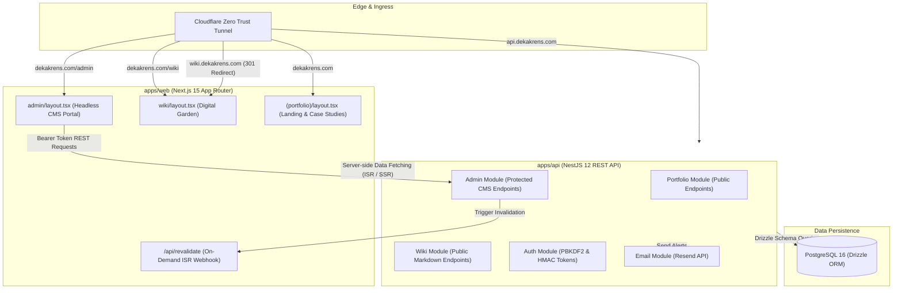

# Deny Kurniawan (@dekakrens) — Platform & Digital Garden

[](https://nextjs.org/)
[](https://react.dev/)
[](https://nestjs.com/)
[](https://orm.drizzle.team/)
[](https://www.postgresql.org/)
[](https://tailwindcss.com/)
[](https://www.docker.com/)
[](https://developers.cloudflare.com/cloudflare-one/connections/connect-networks/)

A high-performance developer portfolio, engineering digital garden, and headless CMS platform engineered with **Next.js 15 (App Router)** and **NestJS 12 + Drizzle ORM + PostgreSQL 16**.

---

## 🌟 Key Features

- **Decoupled Monorepo Architecture**: Clean separation of frontend presentation (`apps/web`) and core business API (`apps/api`).
- **Multi-Layout App Router**: Dedicated layouts for each domain:
  - **Portfolio (`/`)**: High-converting showcase with anchor smooth scrolling, responsive project showcases, dynamic hero cards, and contact form.
  - **Digital Garden (`/wiki`)**: Technical knowledge base with dedicated navigation, reading time estimation, category filtering, and full Markdown rendering.
  - **Admin CMS (`/admin`)**: Self-contained administrative portal with its own responsive sidebar and auth gate.
- **Zero-Dependency Native Authentication**: PBKDF2 with SHA-512 and HMAC session signing using standard Node.js `crypto` (zero bloat, lightning fast).
- **Comprehensive Admin CMS**: Complete management over:
  - **Hero Highlight Cards**: Customize 4 key metrics and icons below social links.
  - **Skills & Competencies**: Hierarchical category groupings and skill badges.
  - **Career Journey**: Employment history timeline with dynamic achievement bullet points.
  - **Feedbacks & Testimonials**: Client and peer recommendations with graceful empty states.
  - **Project Case Studies**: Architecture write-ups, tech stack tags, and repository links.
  - **Digital Garden Articles**: Markdown editor with category management.
  - **Inbound Inquiries**: Contact messages viewer.
- **Instant On-Demand ISR Cache Revalidation**: Every CMS update automatically purges the Next.js cache via tag and path webhooks, delivering instant updates without site rebuilds.
- **Transactional Email**: Form inquiries automatically alert via **Resend** transactional emails.
- **Subdomain Consolidation**: `wiki.dekakrens.com` traffic is redirected with `HTTP 301 Moved Permanently` to `dekakrens.com/wiki`.
- **Production Edge Deployment**: Hosted on self-hosted ARM64/Linux with **Cloudflare Zero Trust Tunnel** ingress.

---

## 🏗️ System Architecture



---

## 📁 Repository Structure

```text
.
├── apps/
│   ├── web/                     # Next.js 15 App Router Frontend
│   │   ├── src/
│   │   │   ├── app/
│   │   │   │   ├── (portfolio)/ # Route Group: Landing Page & Project Case Studies
│   │   │   │   ├── wiki/        # Route Group: Digital Garden / Wiki
│   │   │   │   ├── admin/       # Route Group: Headless Admin CMS
│   │   │   │   └── api/         # ISR Revalidation Webhook
│   │   │   ├── components/      # UI components (Hero, Projects, Navbar, etc.)
│   │   │   ├── lib/             # API clients & ISR fetchers
│   │   │   └── middleware.ts    # 301 subdomain routing
│   │   └── Dockerfile           # Next.js production container
│   │
│   └── api/                     # NestJS 12 Core Backend API
│       ├── src/
│       │   ├── auth/            # Native PBKDF2/HMAC crypto authentication
│       │   ├── admin/           # CMS CRUD & on-demand cache revalidation
│       │   ├── portfolio/       # Public portfolio & profile services
│       │   ├── wiki/            # Public digital garden & markdown endpoints
│       │   ├── database/        # Drizzle ORM schema, seeds & migrations
│       │   └── email/           # Resend notification integration
│       └── Dockerfile           # NestJS production container
│
├── docs/                        # Deep-Dive Project Documentation
│   ├── ARCHITECTURE.md          # Multi-layout routing, schema ER diagram, and security
│   ├── CMS_GUIDE.md             # Complete Admin CMS user guide for all sections
│   ├── DEPLOYMENT.md            # Docker Compose & Cloudflare Tunnel production manual
│   └── API_REFERENCE.md         # Exhaustive REST API specification & OpenAPI docs
│
├── docker-compose.yml           # Local development database container
├── docker-compose.prod.yml      # Production stack (PostgreSQL + API + Web)
├── package.json                 # Monorepo root workspace configuration
└── pnpm-workspace.yaml          # PNPM workspace definition
```

---

## 🚀 Quick Start (Local Development)

### 1. Prerequisites
- **Node.js**: v20+ (recommended v22+)
- **pnpm**: v10+ (recommended v11+)
- **Docker**: For running PostgreSQL locally

### 2. Installation
```bash
# Clone the repository
git clone https://github.com/dekakrens/portfolio.git
cd portfolio

# Install workspace dependencies
pnpm install
```

### 3. Start Local Database & Seed Data
```bash
# Launch PostgreSQL 16 on port 5432
pnpm db:up

# Run Drizzle migrations & seed initial database records
pnpm db:migrate
pnpm db:seed
```

### 4. Run Development Servers
```bash
# Starts both frontend (port 3000) and backend (port 4000)
pnpm dev
```

Or run them individually:
```bash
pnpm dev:web   # Frontend only -> http://localhost:3000
pnpm dev:api   # API only      -> http://localhost:4000
```

- **Portfolio:** [http://localhost:3000](http://localhost:3000)
- **Digital Garden:** [http://localhost:3000/wiki](http://localhost:3000/wiki)
- **Admin CMS:** [http://localhost:3000/admin](http://localhost:3000/admin)
- **Interactive Swagger Docs:** [http://localhost:4000/api/docs](http://localhost:4000/api/docs)

---

## 🛠️ Monorepo Scripts Reference

| Command | Description |
| :--- | :--- |
| `pnpm dev` | Runs both `apps/web` and `apps/api` concurrently in watch mode. |
| `pnpm dev:web` | Starts Next.js frontend in development mode. |
| `pnpm dev:api` | Starts NestJS API with hot reload. |
| `pnpm build` | Compiles both applications for production. |
| `pnpm lint` | Runs type checks and linters across all packages. |
| `pnpm db:up` | Boots the local PostgreSQL container via Docker Compose. |
| `pnpm db:down` | Stops the local PostgreSQL container. |
| `pnpm db:migrate` | Runs Drizzle schema migrations. |
| `pnpm db:seed` | Seeds profile, skills, projects, and initial digital garden articles. |

---

## 📖 Deep-Dive Documentation

For comprehensive technical guides, consult the dedicated documentation in the [`docs/`](docs/) folder:

- 🏛️ [**System Architecture & Data Model**](docs/ARCHITECTURE.md) — Multi-layout App Router strategy, Drizzle schema, ER diagrams, and security architecture.
- 🎛️ [**Admin CMS Management Guide**](docs/CMS_GUIDE.md) — How to manage profile hero cards, projects, skills, career journey, testimonials, and articles.
- 🚢 [**Production Deployment & DevOps**](docs/DEPLOYMENT.md) — Self-hosting guide for Docker Compose, Raspberry Pi, and Cloudflare Tunnel.
- 📡 [**REST API Reference & Endpoints**](docs/API_REFERENCE.md) — Public, Wiki, Authentication, and Admin CMS endpoint specifications.

---

## 🔒 Security & Privacy

- All CMS endpoints are guarded by custom bearer authorization guards.
- No third-party heavy auth dependencies; uses Node.js standard cryptographic primitives (`crypto.pbkdf2Sync`, `crypto.createHmac`, and `crypto.timingSafeEqual`).
- Sensitive environment variables (`DATABASE_URL`, `JWT_SECRET`, `REVALIDATION_SECRET`, `RESEND_API_KEY`) are kept isolated and never committed to source control.

---

## 👤 Author

**Deny Kurniawan** ([@dekakrens](https://github.com/dekakrens))
- **Website**: [https://dekakrens.com](https://dekakrens.com)
- **Digital Garden**: [https://dekakrens.com/wiki](https://dekakrens.com/wiki)
- **LinkedIn**: [linkedin.com/in/dekakrens](https://linkedin.com/in/dekakrens)
- **Email**: [dekakrens@gmail.com](mailto:dekakrens@gmail.com)
