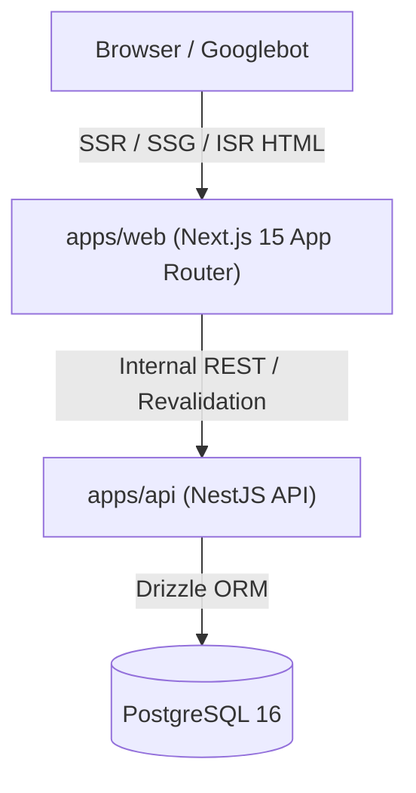

# Deka Krens - Developer Portfolio & Platform

A modern, decoupled, high-performance web platform built with **Next.js 15 (App Router)** and a dedicated **NestJS + Drizzle ORM + PostgreSQL** backend API.

---

## 🏗️ Architecture Overview



- **`apps/web`**: Next.js 15 App Router, React 19, Tailwind CSS v4, Lucide icons, Dark/Light mode theme provider (`next-themes`).
  - **SEO First**: Pre-rendered static pages, dynamic `generateMetadata()`, JSON-LD structured data (`Person`, `TechArticle`), auto-generated `sitemap.xml` and `robots.txt`.
- **`apps/api`**: NestJS 12, Drizzle ORM, PostgreSQL driver (`postgres`), class-validator, Swagger OpenAPI docs (`/api/docs`).
- **`docker-compose.yml`**: Out-of-the-box local PostgreSQL container.

---

## 🚀 Quick Start

### 1. Prerequisites
- **Node.js**: v20+ (tested with v22.20.0)
- **pnpm**: v11+ (or npm/bun)
- **Docker**: (Optional, for local PostgreSQL container)

### 2. Install Dependencies
```bash
pnpm install
```

### 3. Start Database (Optional)
```bash
# Starts local PostgreSQL 16 on port 5432
docker compose up -d

# Push Drizzle schema and seed initial portfolio data
pnpm db:migrate
pnpm db:seed
```

### 4. Run Development Servers
You can run both web and API simultaneously:
```bash
# Runs apps/web on http://localhost:3000
# Runs apps/api on http://localhost:4000
pnpm dev
```

Or run them individually:
```bash
pnpm dev:web   # Next.js frontend only
pnpm dev:api   # NestJS backend only
```

---

## 📚 API Endpoints (`apps/api`)

Explore interactive Swagger documentation at **`http://localhost:4000/api/docs`**

- `GET /api/v1/profile` - Profile, headline, bio, and social links.
- `GET /api/v1/projects` - List of published projects with case studies and tech stacks.
- `GET /api/v1/projects/:slug` - Single project details for dynamic SSR/SSG.
- `GET /api/v1/skills` - Categorized skills matrix.
- `GET /api/v1/experience` - Career timeline and achievements.
- `GET /api/v1/testimonials` - Peer and client recommendations.
- `POST /api/v1/contact` - Validated contact inquiry submission.

---

## 🔍 SEO & Prerendering Verification

Run the production build:
```bash
pnpm build
```

Next.js statically pre-renders all project pages:
- `/` - Home page with Hero, Projects, Skills, Timeline, Testimonials, Contact.
- `/projects/ai-smart-water-meter` - Individual project case study with dynamic Open Graph & JSON-LD.
- `/projects/enterprise-inventory-portal`
- `/projects/lorawan-antenna-tuning`
- `/sitemap.xml` & `/robots.txt`
