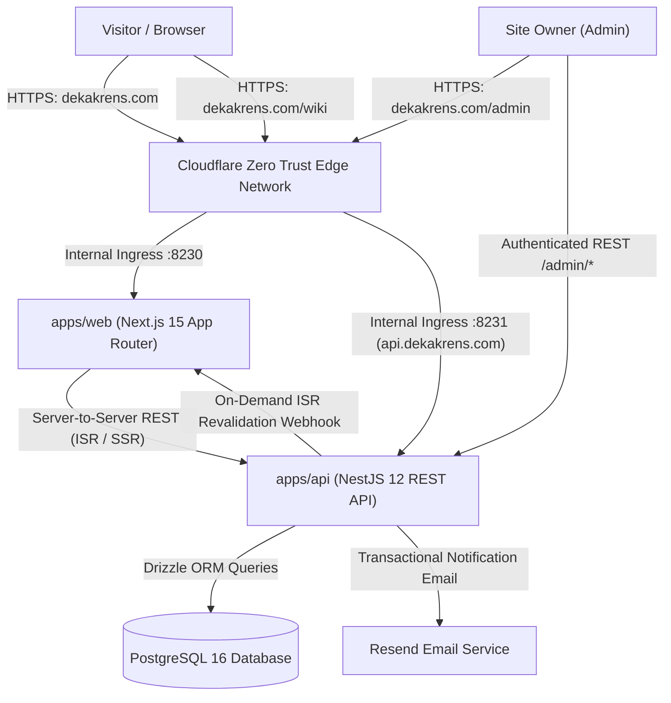
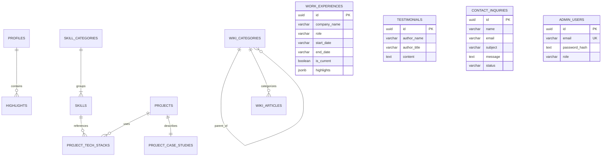
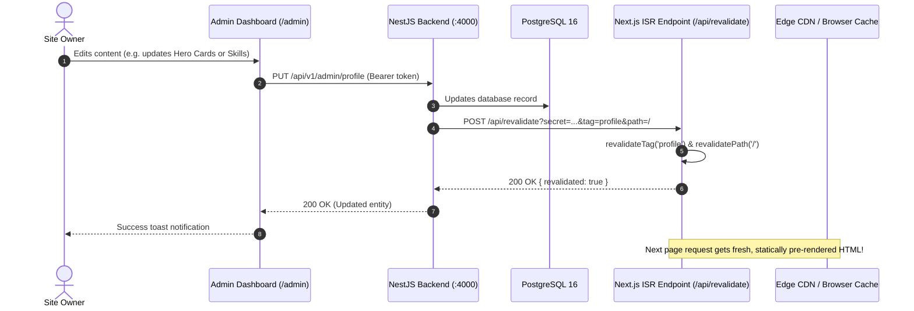

# System Architecture

This document describes the high-level architecture, design decisions, data models, and caching strategies of the **Deka Krens Developer Platform & Digital Garden**.

---

## 1. High-Level System Overview

The platform uses a modern decoupled monorepo architecture:
- **Frontend Presentation Layer (`apps/web`)**: Next.js 15 App Router with React 19, Tailwind CSS v4, Lucide icons, and server-side rendering (SSR) / incremental static regeneration (ISR).
- **Backend Core API Layer (`apps/api`)**: NestJS 12 running on Node.js 22+, Drizzle ORM, class-validator, and Swagger OpenAPI documentation.
- **Data Persistence**: PostgreSQL 16 containerized with Docker.
- **Edge & Networking**: Cloudflare Tunnel providing zero-trust secure ingress directly to the local host without opening public firewall ports.



---

## 2. Multi-Layout Routing Architecture

To prevent layout bleeding (e.g., preventing the marketing portfolio navbar and footer from rendering inside the Admin Dashboard or Digital Garden), the Next.js frontend uses route groups and dedicated segment layouts:

```
apps/web/src/app/
├── layout.tsx              # Root HTML, body, ThemeProvider (no marketing navbar/footer)
│
├── (portfolio)/            # Route Group: Marketing / Showcase
│   ├── layout.tsx          # Renders <Navbar /> and <Footer /> with anchor scrolling
│   ├── page.tsx            # Hero, Metric Cards, Projects, Skills, Timeline, Contact
│   └── projects/[slug]/    # Project Case Study with deep dive & tech stacks
│
├── wiki/                   # Route Group: Digital Garden & Engineering Notes
│   ├── layout.tsx          # Dedicated <WikiNavbar /> ('← Portfolio') and <WikiFooter />
│   ├── page.tsx            # Digital Garden explorer with category filters & search
│   └── [slug]/             # Markdown technical article with TOC & read time
│
└── admin/                  # Route Group: Headless Admin CMS
    ├── layout.tsx          # Dedicated <AdminSidebar />, header, and auth gate
    ├── login/              # Admin authentication screen
    ├── page.tsx            # Dashboard overview with metrics and quick links
    ├── profile/            # Profile bio & 4 dynamic hero highlight cards
    ├── projects/           # Project case study manager
    ├── wiki/               # Technical article markdown editor
    ├── skills/             # Categorized skill chips manager
    ├── experience/         # Career journey timeline manager
    ├── testimonials/       # Feedback & recommendation cards manager
    └── messages/           # Contact inquiries viewer
```

---

## 3. Database Schema & Entity Relationships

The data model is authored using **Drizzle ORM** in PostgreSQL with relational schemas and cascading constraints:



### Table Overview

| Table | Purpose | Key Features |
| :--- | :--- | :--- |
| `profiles` | Developer identity and hero content | JSONB `highlights` (4 metric cards), JSONB `social_links`, bio, status badge. |
| `skill_categories` | Skill groupings | Display ordering, hierarchical naming (Frontend, Backend, IoT, DevOps). |
| `skills` | Individual technologies & competencies | Icon slug, featured flag, relational link to category. |
| `projects` | Portfolio case studies | Slug, thumbnail URL, live URL, repo URL, featured toggle. |
| `project_case_studies`| In-depth case study write-up | Architecture description, challenges, key features JSONB, measurable results. |
| `project_tech_stacks` | Many-to-many junction | Links projects to skills. |
| `work_experiences` | Career journey timeline | Date range, current employer flag, JSONB bullet points. |
| `testimonials` | Client & peer endorsements | Quote content, author title, company, LinkedIn link. |
| `wiki_categories` | Digital Garden taxonomy | Slugs, parent category support for sub-topics. |
| `wiki_articles` | Long-form technical writings | Markdown body, reading time estimation, publishing status. |
| `contact_inquiries` | Inbound contact submissions | Contact details, message body, read/unread status. |
| `admin_users` | CMS administration accounts | Salted PBKDF2 password hashes, role-based controls. |

---

## 4. Authentication & Security Architecture

1. **Native Cryptography (Zero External Auth Bloat)**:
   - Password hashing uses Node.js standard `crypto.pbkdf2Sync` (10,000 iterations, 64-byte key length, SHA-512, unique random 16-byte salt).
   - Session tokens use stateless cryptographically signed payloads:
     $$\text{Token} = \text{Base64Url}(\text{Header}) + "." + \text{Base64Url}(\text{Payload}) + "." + \text{HMAC-SHA256}(\dots)$$
   - Verification uses `crypto.timingSafeEqual` to prevent timing attacks.
2. **Automatic Idempotent Admin Bootstrap**:
   - On startup, the NestJS `AuthService` inspects the `admin_users` table. If no administrator account exists, it automatically seeds the admin defined by `ADMIN_EMAIL` and `ADMIN_PASSWORD` from environment variables.
3. **Subdomain Security & Redirects**:
   - `wiki.dekakrens.com` requests are permanently redirected with an `HTTP 301 Moved Permanently` to `https://dekakrens.com/wiki/:path*` via Next.js middleware, preventing fragmented domain authority and duplicate content SEO penalties.

---

## 5. On-Demand ISR Cache Invalidation Lifecycle

The platform uses Next.js Incremental Static Regeneration (ISR) with tag-based caching for optimal time-to-first-byte (TTFB) and instant updates:


